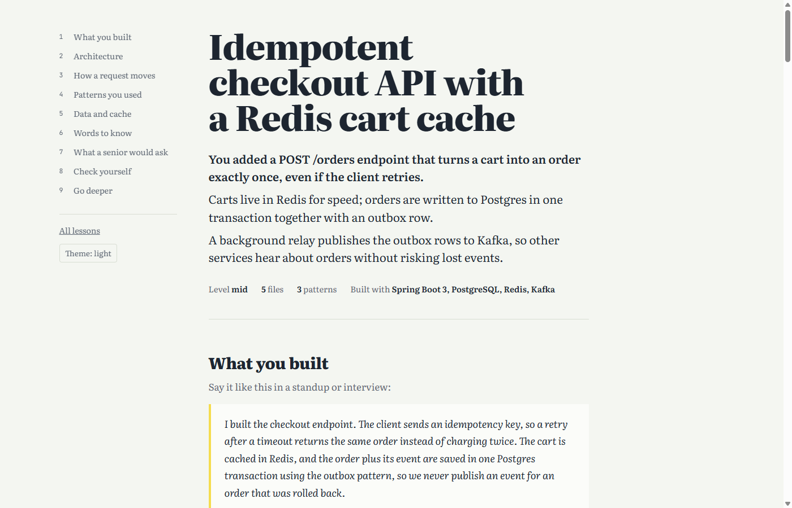
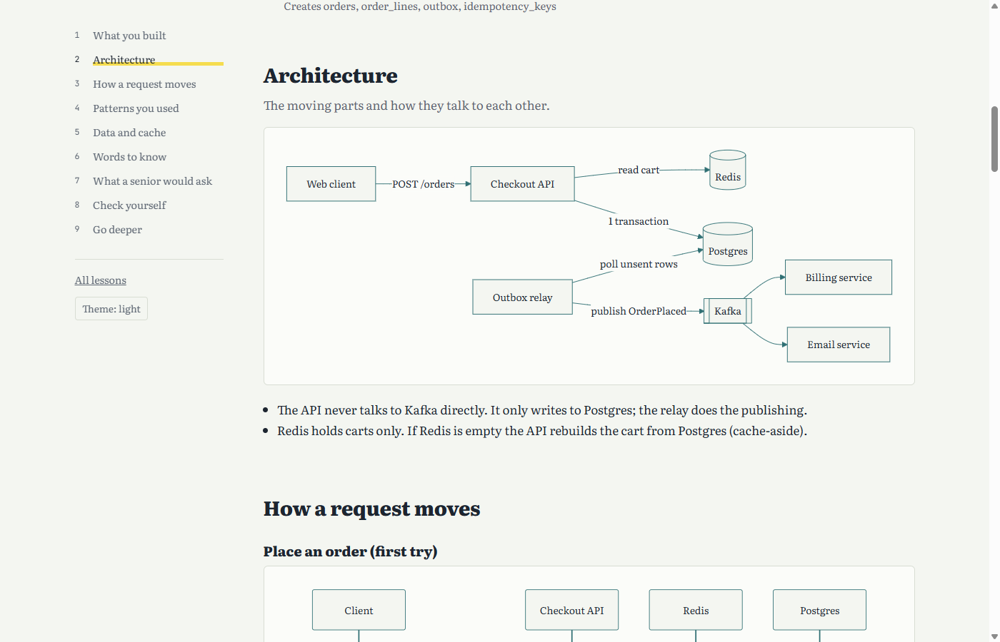

# learn

**Type `/learn` after you build something, and get a visual lesson about what you just did.**

A Claude Code plugin. It reads your session and your git diff, then opens a page in your browser that explains your work: the architecture, how a request moves through it, the design patterns you used (with links to the exact lines), your database and cache choices, the words you should know, and a short quiz.





## Why

You shipped a feature with an AI pair. It works. Could you explain it in a standup, defend it in a design review, or answer "what happens if Redis is down?" in an interview?

`/learn` turns the work you just did into the lesson you would have gotten from a senior engineer walking you through it.

## Install

In Claude Code:

```
/plugin marketplace add talayash/learn
/plugin install learn@learn
```

Requires Node 18 or newer (Claude Code already needs it).

<details>
<summary>Install without the plugin system</summary>

Copy the skill into your personal skills folder:

```bash
git clone https://github.com/talayash/learn
cp -r learn/skills/learn ~/.claude/skills/learn
```

</details>

## Use

| Command | What it explains |
|---|---|
| `/learn` | What you built in this session (falls back to uncommitted changes, then your branch) |
| `/learn last-commit` | The last commit |
| `/learn main..HEAD` | Any git range |
| `/learn src/payments` | A file or folder as it is now |
| `/learn --level senior` | Same, but focused on trade-offs and failure modes. Also `junior` and `mid` (default). |

Each lesson is saved to `.learn/<date>-<topic>.html` in your repo, and `.learn/index.html` lists every lesson you have generated. Add `.learn/` to `.gitignore` if you do not want to commit them.

## What a lesson contains

Sections only appear when they apply. A CSS refactor will not get a database section.

- **What you built**: a three-line summary, a 30-second explanation in your own voice, and the files that matter
- **Architecture**: a diagram of the components and how they connect
- **How a request moves**: sequence diagrams with a plain-language walkthrough
- **Patterns you used**: each pattern explained in general, then in your code, with clickable `file:line` links (they open in VS Code) and what it gains and costs
- **Data and cache**: ER diagram, why each table exists, cache keys, TTLs and strategy
- **Words to know**, **What a senior would ask**, **Check yourself** (quiz), **Go deeper** (curated links)

Light and dark themes, works on phones, prints cleanly.

## How it works

```
/learn  ->  Claude reads the session + git diff
        ->  writes lesson.json (a fixed schema)
        ->  render.mjs injects it into template.html
        ->  .learn/2026-10-20-checkout-api.html opens in your browser
```

Claude only writes data. The page design lives in one template, so every lesson looks the same and costs fewer tokens than generating HTML each time. Diagrams are [Mermaid](https://mermaid.js.org), rendered in the browser.

**Privacy:** nothing about your code leaves your machine beyond what Claude Code already sends. The generated page loads Mermaid and two Google Fonts from public CDNs; everything else is inline.

## Repository layout

```
.claude-plugin/        plugin and marketplace manifests
commands/learn.md      the /learn slash command
skills/learn/
  SKILL.md             analysis steps and the lesson JSON schema
  template.html        the page: design, diagrams, quiz
  render.mjs           JSON -> HTML, history index, opens the browser
examples/              a sample lesson
tests/                 renderer tests
```

## Try the renderer without Claude

```bash
node skills/learn/render.mjs examples/checkout-api.json
```

## Contributing

Design changes go in `skills/learn/template.html`. Changes to what Claude analyzes go in `skills/learn/SKILL.md`. If you add a field to the schema, update both, plus `examples/checkout-api.json`.

```bash
npm test
```

Lesson text is always inserted with `textContent`, and the JSON is escaped so it cannot close its `<script>` tag. Please keep it that way; the tests check it.

## License

MIT
